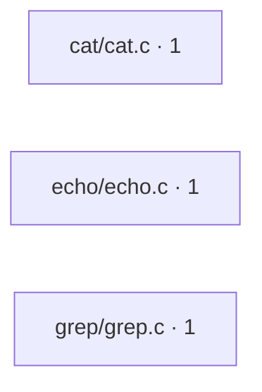

# Codemap: minicoreutils

← [README](README.md)

> Generated from commit `ebd649d` by `scripts/codemap.py`. Regenerate it from the workspace root with `python3 scripts/codemap.py minicoreutils`; don't edit it by hand.

## Files

Each box is a source file and its function count; an arrow means calls into that file.

## Functions

### `cat/cat.c`

- `main()` L3

### `echo/echo.c`

- `main()` L4

### `grep/grep.c`

- `main()` L4
