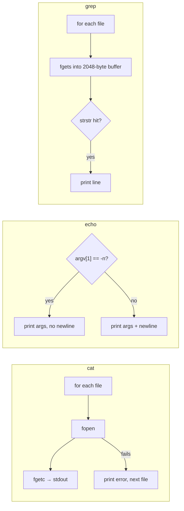

# minicoreutils

> From-scratch `cat`, `echo` and `grep` in C, using nothing but the standard library.


## Overview

Three single-file utilities, one directory each. The point is to get file I/O, `argv` walking and line buffers down by hand before bigger systems work.

## How They Work



| Program | Mirrors | Notes |
|---|---|---|
| `cat/cat.c` | `cat` | Streams each file a character at a time; a missing file is skipped, not fatal |
| `echo/echo.c` | `echo` | Space-separated args; `-n` drops the newline |
| `grep/grep.c` | `grep` | Plain substring match (`strstr`), no regex |

**Left out on purpose:** line numbers, recursion, case-insensitivity.
**Differences from GNU:** errors go to stdout, `cat` with no files doesn't read stdin, and `grep` splits lines longer than 2,047 characters.

## Build

```bash
gcc cat/cat.c -o cat && ./cat file.txt
gcc echo/echo.c -o echo && ./echo -n hello world
gcc grep/grep.c -o grep && ./grep search_term file.txt
```

**Codemap:** [CODEMAP.md](CODEMAP.md), the files, hub functions and call graph, generated from the code.

---
*powered by logic, coffee, and many sleepless nights*
